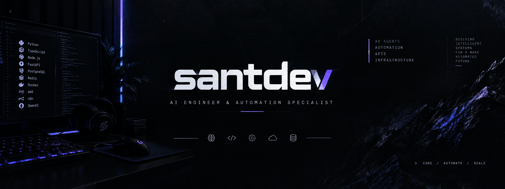

<div align="center">



<br>
<br>

# santdev

### AI Engineer · Automation · Intelligent Systems

Building intelligent systems that connect AI, automation, APIs and infrastructure.

<br>

<a href="https://github.com/santdevfull">
  
</a>
<a href="https://openai.com">
  
</a>
<a href="https://n8n.io">
  
</a>
<a href="https://www.python.org">
  
</a>

</div>

---

## `01` — About

I'm an **AI Engineer & Automation Specialist** focused on building
intelligent systems that solve real-world problems.

My work combines:

- Artificial Intelligence
- LLM-powered applications
- AI Agents
- Workflow Automation
- APIs & Webhooks
- Backend systems
- Databases
- Cloud infrastructure

I focus on turning AI capabilities into **reliable systems that can
understand context, execute workflows, integrate with external services
and operate in production.**

---

## `02` — What I Build

<table>
<tr>

<td width="50%" valign="top">

### 🤖 AI Agents

Intelligent systems built around LLMs and structured decision-making.

```text
LLM
 ↓
Context
 ↓
Agent
 ↓
Tools / APIs
 ↓
Action
```

</td>
</tr>
</table>

---

## 03 - Software Portfolio

**15 working projects**, from browser utilities to persistent backend services, with 50 automated tests and GitHub Actions CI.

[**Explore the interactive portfolio**](https://santdevfull.github.io/santdevfull/) | [Project catalog](projects/CATALOG.md) | [Portfolio CI](https://github.com/santdevfull/santdevfull/actions/workflows/portfolio-ci.yml)

| Project | Difficulty | Stack | Preview |
|---|---|---|---|
| [HabitFlow](https://github.com/santdevfull/habitflow) | Simple | JavaScript | [Live demo](https://santdevfull.github.io/santdevfull/habitflow/) |
| [FocusForge](https://github.com/santdevfull/focusforge) | Simple | JavaScript | [Live demo](https://santdevfull.github.io/focusforge/) |
| [ChromaCheck](https://github.com/santdevfull/chromacheck) | Simple | Accessibility / JS | [Live demo](https://santdevfull.github.io/chromacheck/) |
| [NoteVault](https://github.com/santdevfull/notevault) | Simple | JavaScript | [Live demo](https://santdevfull.github.io/notevault/) |
| [TypeMeter](https://github.com/santdevfull/typemeter) | Simple | JavaScript | [Live demo](https://santdevfull.github.io/typemeter/) |
| [BudgetLab](https://github.com/santdevfull/budgetlab) | Medium | Data / JavaScript | [Live demo](https://santdevfull.github.io/santdevfull/budgetlab/) |
| [SprintBoard](https://github.com/santdevfull/sprintboard) | Medium | Kanban / JavaScript | [Live demo](https://santdevfull.github.io/sprintboard/) |
| [StudyLoop](https://github.com/santdevfull/studyloop) | Medium | Education / JS | [Live demo](https://santdevfull.github.io/studyloop/) |
| [InvoiceKit](https://github.com/santdevfull/invoicekit) | Medium | Business / JavaScript | [Live demo](https://santdevfull.github.io/invoicekit/) |
| [DataLens](projects/datalens) | Medium | CSV / JavaScript | [Live demo](https://santdevfull.github.io/santdevfull/datalens/) |
| [PulseOps](https://github.com/santdevfull/pulseops) | Advanced | FastAPI / SQLite | [Live demo](https://santdevfull.github.io/santdevfull/pulseops/demo/) |
| [FlagPilot](projects/flagpilot) | Advanced | FastAPI / Feature flags | [API docs](https://santdevfull.github.io/santdevfull/flagpilot/) |
| [QueueCraft](projects/queuecraft) | Advanced | FastAPI / Job queue | [API docs](https://santdevfull.github.io/santdevfull/queuecraft/) |
| [LedgerForge](projects/ledgerforge) | Advanced | FastAPI / Ledger | [API docs](https://santdevfull.github.io/santdevfull/ledgerforge/) |
| [EventShield](projects/eventshield) | Advanced | FastAPI / Security | [API docs](https://santdevfull.github.io/santdevfull/eventshield/) |

**Backend transparency:** API documentation pages are static. Run the Python APIs locally or deploy their Docker containers to interact with real endpoints.

## 04 - Engineering practices

- CI: unit and integration tests on every push and pull request.
- CD: GitHub Pages for browser demos and static API documentation.
- Quality: integer-cent calculations, deterministic rollout, SQLite transactions, HMAC verification, accessibility and validation.
- Maintainable independent projects: READMEs, source, tests, licenses and deployment workflows.

All projects are educational portfolio examples and not production services.
