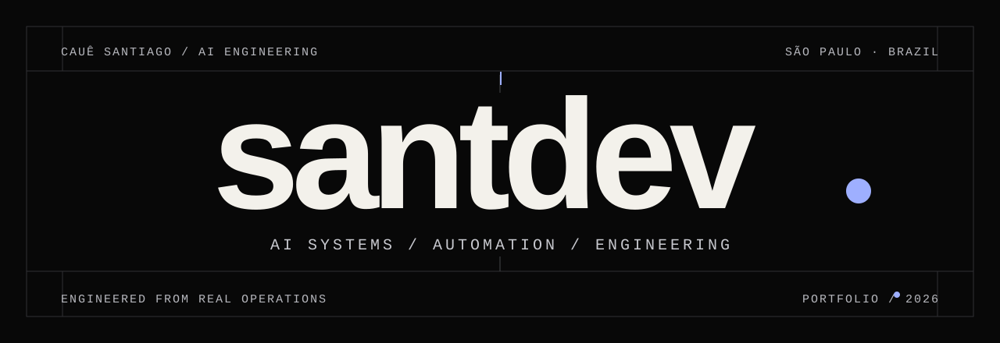
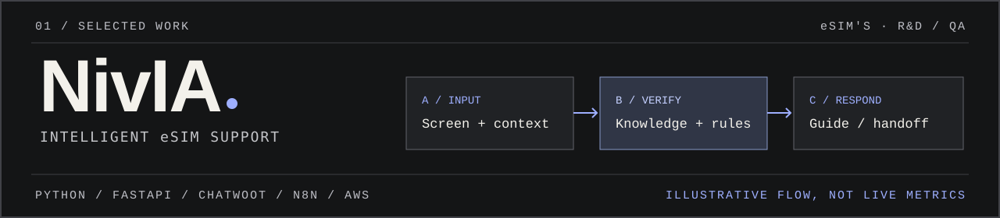

<!--
  santdev / GitHub profile
  Editorial style: projects/editorial.css + projects/design-tokens.json
  Render-safe Markdown and SVG only; no external badge counters or telemetry.
-->

  

  <strong>Cauê Santiago</strong> &nbsp;·&nbsp; Especialista IA na eSIM’s &nbsp;·&nbsp; Remoto, Brasil

  <a href="https://santdevfull.github.io/santdevfull/">PORTFÓLIO ↗</a>
  &nbsp;&nbsp; / &nbsp;&nbsp;
  <a href="https://www.linkedin.com/in/cau%C3%AA-santiago-6432a4229">LINKEDIN ↗</a>
  &nbsp;&nbsp; / &nbsp;&nbsp;
  <a href="mailto:santdev.contato@gmail.com">CONTATO ↗</a>
  &nbsp;&nbsp; / &nbsp;&nbsp;
  <a href="./docs/PROFILE_EN.md">ENGLISH ↗</a>

---

### 01 / Da operação aos sistemas inteligentes

Trabalho na interseção entre **IA aplicada, automação e engenharia de software**, usando experiência prática em suporte, infraestrutura e operações de TI para criar soluções com contexto, rastreabilidade e testes.

Desde **maio de 2026**, atuo como **Especialista IA na eSIM’s**, de forma autônoma e remota. Desenvolvo e evoluo agentes de IA, automações em Python, fluxos no n8n e integrações com Chatwoot, Odoo CRM, APIs REST e bases de conhecimento. Também trabalho com engenharia de prompts, triagem, tratamento de exceções, documentação e melhoria contínua.

A proposta é simples: **entender o problema antes de automatizar a solução.**

---

### 02 / Trabalho selecionado

  

**NivIA · eSIM’s — agentes de IA e suporte contextual**

Desenvolvimento, integração e validação em **QA** de fluxos de suporte eSIM N1/N2, combinando interpretação de capturas de tela, conhecimento, regras de roteamento e escalonamento humano. Stack: **Python, FastAPI, Chatwoot, n8n, Vision e AWS**. *Case de engenharia/P&D: não representa métricas ou publicação produtiva.*

**Oliv-e Saúde — automação de Service Desk**

Implementação de processos no **Jira Service Management**, integrações Python/API, chatbot de triagem e documentação de troubleshooting. Resultados registrados no histórico profissional: **aproximadamente 30% menos tickets manuais** e **mais de 40 artigos técnicos**.

**Abyssal Bio-Fish Farm — engenharia de jogo e simulação**

Projeto independente de prototipagem no Roblox, com **Luau**, assets **Blender**, integração com Roblox Studio e testes locais de multiplayer e persistência. *Candidato privado de playtest; não lançado publicamente.*

→ [Ver os estudos de caso no portfólio](https://santdevfull.github.io/santdevfull/#cases)

---

### 03 / Código, experimentos e sistemas

**15 projetos públicos**, entre aplicações web e APIs. O código é aberto; demos web e documentações de backend são identificadas separadamente.

**01 — Experiências web e acessibilidade**

[HabitFlow](https://github.com/santdevfull/habitflow) · [FocusForge](https://github.com/santdevfull/focusforge) · [ChromaCheck](https://github.com/santdevfull/chromacheck) · [NoteVault](https://github.com/santdevfull/notevault) · [TypeMeter](https://github.com/santdevfull/typemeter)

**02 — Produtividade, dados e interfaces**

[BudgetLab](https://github.com/santdevfull/budgetlab) · [SprintBoard](https://github.com/santdevfull/sprintboard) · [StudyLoop](https://github.com/santdevfull/studyloop) · [InvoiceKit](https://github.com/santdevfull/invoicekit) · [DataLens](./projects/datalens)

**03 — Backends, arquitetura e operações**

[PulseOps](https://github.com/santdevfull/pulseops) · [FlagPilot](./projects/flagpilot) · [QueueCraft](./projects/queuecraft) · [LedgerForge](./projects/ledgerforge) · [EventShield](./projects/eventshield)

→ [Explorar os 15 projetos e demonstrações](https://santdevfull.github.io/santdevfull/#projects)

---

### 04 / Trajetória profissional

**2026 → agora** · **eSIM’s** — Especialista IA, autônomo/remoto. Agentes de IA, prompts, Python, n8n, CRM, integrações e QA.

**2025–2026** · **Oliv-e Saúde** — Analista de TI. Automações, suporte, ITSM e Jira Service Management.

**2025** · **Helibras** — Suporte N2. Windows, Active Directory, rede e incidentes complexos.

**2024–2025** · **Hitss Brasil** — Suporte SAP. SAP ECC/MM, acessos e ITSM.

**2022–2023** · **Tech Mahindra** — Suporte N1. Service Desk global, identidade, acessos e onboarding.

→ [Ver a trajetória completa](https://santdevfull.github.io/santdevfull/#experience)

---

### 05 / Ferramentas e fundamentos

**IA + automação** &nbsp; Python · FastAPI · agentes de IA · n8n · webhooks · APIs REST · Odoo CRM · Chatwoot · Vision QA

**Desenvolvimento** &nbsp; JavaScript · SQL · PostgreSQL · SQLite · Redis · Docker · GitHub Actions · testes automatizados

**Operações + cloud** &nbsp; AWS / Lightsail · Azure · Linux · Windows Server · Active Directory · Entra ID · ITSM

**Formação** &nbsp; Análise e Desenvolvimento de Sistemas — Universidade Anhembi Morumbi (2024–2026; conclusão não confirmada).

**Certificações informadas** &nbsp; ITIL 4 Foundation (2024) · Microsoft AZ-900 (2024) · AWS Cloud Practitioner (2025).

---

  <strong>Construir com contexto. Validar antes de escalar.</strong> 
  Para colaborar em IA, automação ou engenharia de software:  
  <a href="mailto:santdev.contato@gmail.com">santdev.contato@gmail.com</a>
  &nbsp;·&nbsp;
  <a href="https://santdevfull.github.io/santdevfull/">santdev — portfólio</a>

