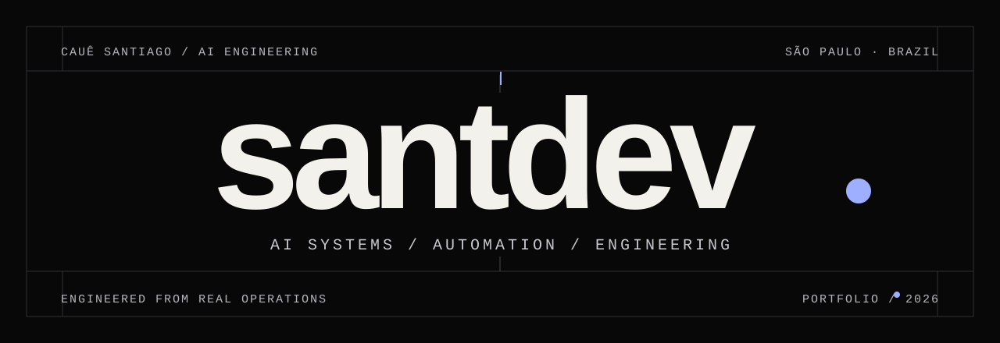
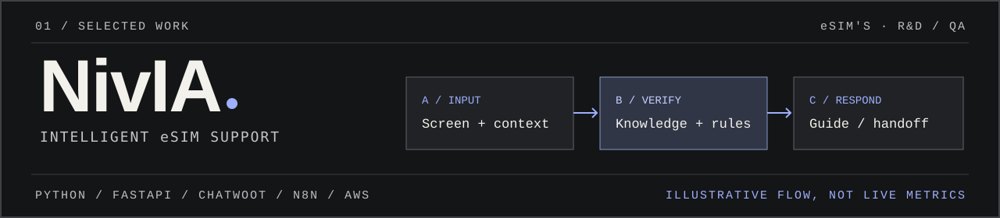

<!-- English edition of the santdev GitHub profile. -->

<strong>Cauê Santiago</strong> · AI Specialist at eSIM’s · Remote, Brazil

<a href="https://santdevfull.github.io/santdevfull/">PORTFOLIO ↗</a> &nbsp;/&nbsp; <a href="https://www.linkedin.com/in/cau%C3%AA-santiago-6432a4229">LINKEDIN ↗</a> &nbsp;/&nbsp; <a href="mailto:santdev.contato@gmail.com">CONTACT ↗</a> &nbsp;/&nbsp; <a href="../README.md">PORTUGUÊS ↗</a>

---

### 01 / From operations to intelligent systems

I build at the intersection of **applied AI, automation and software engineering**. My IT support and infrastructure background helps me understand real operational constraints and deliver verifiable systems.

Since **May 2026**, I have worked remotely as a **self-employed AI Specialist at eSIM’s**, developing AI agents, Python automations and n8n workflows integrated with Chatwoot, Odoo CRM, REST APIs and knowledge bases. I also handle prompt refinement, decision flows, triage, exceptions, documentation and continuous improvement.

**Understand the problem before automating the solution.**

---

### 02 / Selected work

**NivIA · eSIM’s — AI support engineering**

Development, integration and **QA validation** of conversational N1/N2 eSIM support, combining screen recognition, knowledge-driven guidance, safe routing and human escalation. Stack: **Python, FastAPI, Chatwoot, n8n, Vision and AWS**. *R&D/QA case study; no live production metrics or deployment claim.*

**Oliv-e Saúde — Service Desk automation**

Jira Service Management processes, Python/API integrations, chatbot triage and technical troubleshooting documentation. Results reported in the professional résumé: **approximately 30% fewer manual tickets** and **40+ technical knowledge articles**.

**Abyssal Bio-Fish Farm — 3D/gameplay prototyping**

Private Roblox prototype developed with **Luau** and **Blender**, with local multiplayer and persistence QA. *Private playtest candidate, not a publicly released game.*

→ [Explore selected case studies](https://santdevfull.github.io/santdevfull/#cases)

---

### 03 / Open software projects

**15 public projects**. Browser demos and API code/documentation are presented separately.

**01 — Frontend and accessibility**

[HabitFlow](https://github.com/santdevfull/habitflow) · [FocusForge](https://github.com/santdevfull/focusforge) · [ChromaCheck](https://github.com/santdevfull/chromacheck) · [NoteVault](https://github.com/santdevfull/notevault) · [TypeMeter](https://github.com/santdevfull/typemeter)

**02 — Productivity and data**

[BudgetLab](https://github.com/santdevfull/budgetlab) · [SprintBoard](https://github.com/santdevfull/sprintboard) · [StudyLoop](https://github.com/santdevfull/studyloop) · [InvoiceKit](https://github.com/santdevfull/invoicekit) · [DataLens](../projects/datalens)

**03 — Backend systems and operations**

[PulseOps](https://github.com/santdevfull/pulseops) · [FlagPilot](../projects/flagpilot) · [QueueCraft](../projects/queuecraft) · [LedgerForge](../projects/ledgerforge) · [EventShield](../projects/eventshield)

→ [Browse all 15 demos and projects](https://santdevfull.github.io/santdevfull/#projects)

---

### 04 / Career

**2026 → present** · **eSIM’s** — AI Specialist (self-employed, remote); AI agents, Python, n8n, APIs, CRM and QA.

**2025–2026** · **Oliv-e Saúde** — IT Analyst; Jira, ITSM, API automation and service operations.

**2025** · **Helibras** — L2 Support; Windows, Active Directory and networks.

**2024–2025** · **Hitss Brasil** — SAP Support; SAP ECC/MM and ITSM.

**2022–2023** · **Tech Mahindra** — L1 Support; global Service Desk, access management and onboarding.

→ [View the full career story](https://santdevfull.github.io/santdevfull/#experience)

---

### 05 / Technology and foundations

**AI + automation** &nbsp; Python · FastAPI · AI agents · n8n · webhooks · REST APIs · Odoo CRM · Chatwoot · Vision QA

**Engineering** &nbsp; JavaScript · PostgreSQL · SQLite · Redis · Docker · GitHub Actions · testing

**Cloud + operations** &nbsp; AWS / Lightsail · Azure · Linux · Windows Server · Entra ID · Active Directory · ITSM

**Education:** Systems Analysis and Development, Anhembi Morumbi University (2024–2026; graduation not confirmed).

**Reported certifications:** ITIL 4 Foundation (2024) · Microsoft AZ-900 (2024) · AWS Cloud Practitioner (2025).

---

<strong>Build with context. Verify before scaling.</strong>  <a href="mailto:santdev.contato@gmail.com">santdev.contato@gmail.com</a> · <a href="https://santdevfull.github.io/santdevfull/">santdev — portfolio</a>

